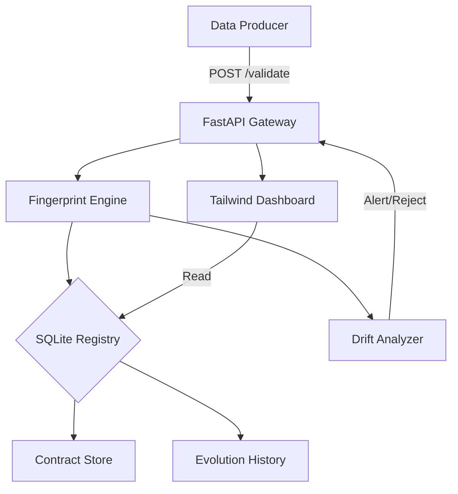

# ARCHITECTURE.md: SchemaEvolutionTracker

## 1. High-Level System Topology

The system follows a decoupled producer-consumer architecture where the `SchemaEvolutionTracker` acts as a sidecar or middleware service. It intercepts data payloads, computes structural fingerprints, and performs differential analysis against versioned contracts.



## 2. Tech Stack Rationale

*   **Python 3.11+**: Utilizes `TaskGroup` for concurrent fingerprinting and `Self` type hinting for fluent API design.
*   **Pydantic v2**: Core validation engine. Leveraging Rust-based core for high-performance schema parsing and serialization.
*   **FastAPI**: Asynchronous request handling with `uvicorn` and `gunicorn` workers for production concurrency.
*   **SQLite (with APSW)**: Chosen for local-first reliability. Using `APSW` (Another Python SQLite Wrapper) instead of `sqlite3` for better performance and explicit transaction control.
*   **Tailwind CSS**: Utility-first styling for the dashboard to ensure zero-runtime CSS overhead and rapid UI iteration.
*   **SQLAlchemy 2.0 (Async)**: Used strictly as a query builder/ORM for the SQLite backend to maintain strict type safety.

## 3. Module & Directory Layout

```text
/schema_evolution_tracker
├── /api              # FastAPI routes and dependency injection
├── /core             # Fingerprint calculation and drift algorithms
├── /db               # SQLAlchemy models and migration scripts
├── /models           # Pydantic v2 schemas for contract definitions
├── /services         # Business logic layer (Validation, Alerting)
├── /ui               # Tailwind/Jinja2 templates and static assets
├── /tests            # Pytest suite with hypothesis-based property testing
├── main.py           # Application entry point
└── pyproject.toml    # Poetry dependency management
```

## 4. Data Flow & Component Interaction Pipeline

1.  **Ingestion**: Incoming JSON/DataFrame payloads are ingested via `FastAPI` endpoints.
2.  **Fingerprinting**: The `FingerprintEngine` computes a structural hash (Merkle-tree based) of the schema, including field types, nullability, and statistical distributions (mean/std/cardinality).
3.  **Contract Resolution**: The system fetches the "Active Contract" from the SQLite registry based on the `schema_id` and `version_tag`.
4.  **Drift Analysis**:
    *   **Strict Mode**: Exact match required on schema structure.
    *   **Loose Mode**: Statistical thresholding (e.g., Kolmogorov-Smirnov test for distribution drift).
5.  **Persistence**: If the schema is new or evolved, the `EvolutionManager` updates the SQLite registry, creating a new versioned snapshot.
6.  **Response**: The API returns a `ValidationResult` object containing the drift score and status.

## 5. Security & Boundary Isolation

*   **Input Sanitization**: All incoming data frames are processed through a Pydantic `StrictModel` to prevent injection attacks and malformed schema definitions.
*   **Boundary Isolation**: The `FingerprintEngine` operates in a restricted memory space; it does not execute arbitrary code. It only performs structural analysis on the schema metadata.
*   **Database Security**: SQLite is configured with `PRAGMA journal_mode=WAL` for concurrency and `PRAGMA foreign_keys=ON` to maintain relational integrity. Access is restricted via file-system permissions at the OS level.
*   **Rate Limiting**: Integrated `slowapi` middleware to prevent DoS attacks on the validation endpoint.
*   **Dependency Pinning**: All dependencies are strictly pinned in `poetry.lock` with hash verification to prevent supply-chain vulnerabilities.